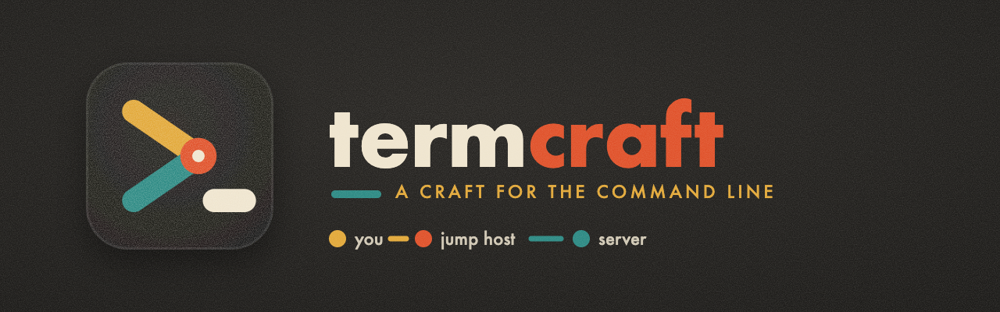
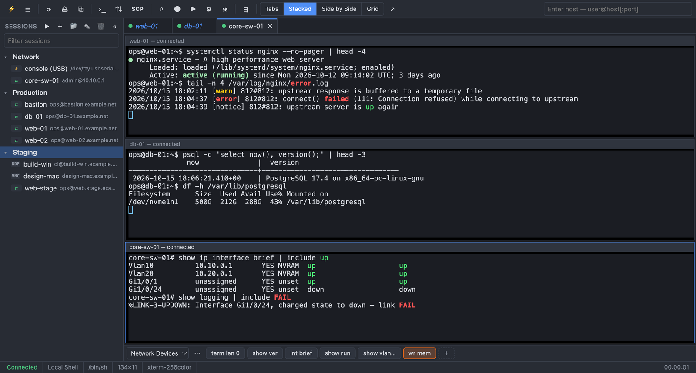
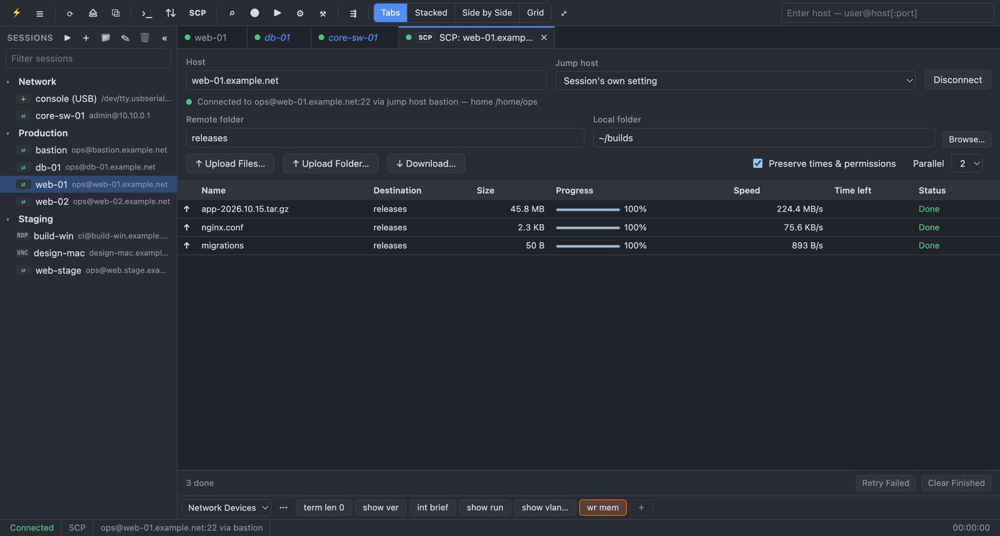
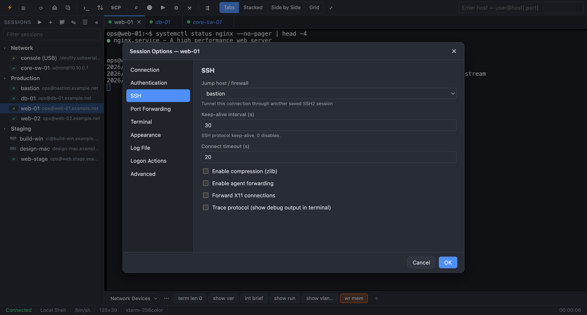
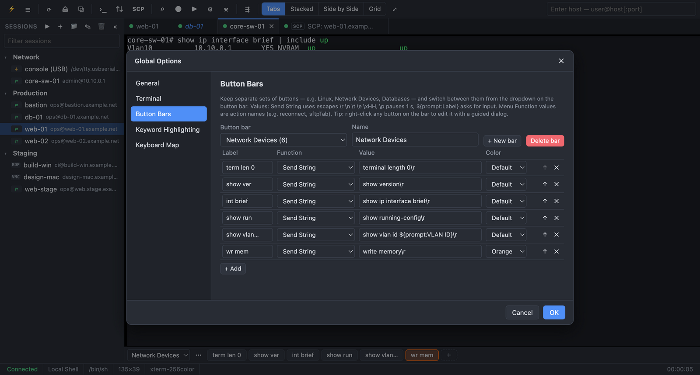
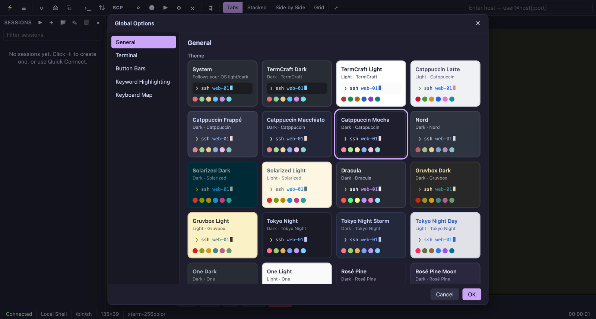

<p align="center">
  
</p>

<p align="center">
  <a href="https://github.com/figgarden/termcraft/actions/workflows/ci.yml"></a>
  <a href="https://github.com/figgarden/termcraft/releases/latest"></a>
  <a href="LICENSE"></a>
  
</p>

**TermCraft** is a free and open-source terminal and session manager for people who live on remote machines. It handles SSH, Telnet, serial consoles, SFTP/SCP transfers, VNC and RDP, organized in one place, with jump hosts, port forwarding, button bars and scripting.

<p align="center">
  
</p>

## Download

Get the latest version from **[Releases](https://github.com/figgarden/termcraft/releases/latest)**:

| Platform | File |
|---|---|
| **macOS** (Apple silicon & Intel) | `.dmg` (or `.zip`) |
| **Windows** 10/11 (x64) | `Setup .exe` installer, or the portable `.exe` |
| **Linux** (x64) | `.AppImage`, `.deb` (Debian/Ubuntu) or `.rpm` (Fedora/RHEL) |

> **First launch on macOS:** TermCraft isn't notarized with Apple yet, so macOS will say it can't verify the developer. Open it once from **System Settings → Privacy & Security → Open Anyway**. **On Windows**, SmartScreen may ask for confirmation (**More info → Run anyway**).

## Highlights

- **Every protocol in one place:** SSH2, Telnet, Rlogin, serial, raw TCP, local shells, plus a built-in **VNC** viewer and **RDP** launching.
- **Session Manager:** folders, filter, drag and drop, import from `~/.ssh/config`, and connecting a whole folder at once.
- **Reach anything:** jump hosts, local/remote/SOCKS port forwarding, and SSH tunnels for VNC and RDP.
- **Work faster:** button bars (one set per device type), a command window that types into every tab, keyword highlighting and JavaScript automation.
- **Move files:** a two-pane SFTP browser and an SCP transfer manager, both of which work through jump hosts.
- **Your layout:** tabs, stacked, side by side or grid. Collapse everything for a full-screen terminal.
- **Themes:** 26 built-in themes from the open-source world: Catppuccin, Nord, Solarized, Dracula, Gruvbox, Tokyo Night, One Dark, Rosé Pine, Everforest, Kanagawa, GitHub and more. They recolor the whole app and your terminals.
- **Secure by default:** host-key verification, logins encrypted in your OS keychain, and a sandboxed UI. See [SECURITY.md](SECURITY.md).

| | |
|---|---|
|  |  |
| **SCP transfers** through a jump host | **Session options:** jump host, keep-alive, forwarding |
|  |  |
| **Button bars** for every kind of device | **26 themes:** Catppuccin, Nord, Solarized, Gruvbox… |

## Features

| Area | What's included |
|---|---|
| **Protocols** | SSH2, Telnet (with option negotiation: NAWS, TTYPE, ECHO, SGA, BINARY), Rlogin, Serial (COM/tty with baud, data bits, parity, stop bits, flow control), Raw TCP, Local Shell (PTY), VNC (built in), RDP (via the system client) |
| **SSH2 auth** | Public key (with passphrase prompt), keyboard-interactive (MFA), password with retry, SSH agent (ssh-agent, Pageant, Windows OpenSSH agent). You choose the method order. |
| **SSH2 extras** | Host key verification with a known-hosts store and a warning when a key changes, jump host / firewall chaining, local, remote and dynamic (SOCKS4/4a/5) port forwarding, X11 forwarding, agent forwarding, compression, keep-alive, protocol trace, cipher shown in the status bar |
| **Session Manager** | Folder tree, filter, drag and drop, connect a whole folder, duplicate, rename, per-session options, import from `~/.ssh/config` (including ProxyJump), JSON import and export |
| **Quick Connect** | Dialog (`⌘Q` / `Ctrl+Shift+Q`) plus an "Enter host" box in the toolbar that accepts `user@host:port` and `telnet://host` |
| **Tabs & tiling** | Tabs, tile vertically, tile horizontally, grid. Clone session, reconnect (Enter on a dead tab), auto-reconnect, activity indicators, drag to reorder, rename |
| **Terminal** | xterm-256color/VT100/VT220/ANSI/Linux, truecolor, Unicode 11, 8 color schemes, per-session fonts and cursor, scrollback, find (regex, case), clickable links (Ctrl/⌘+click), character encodings |
| **Clipboard** | Copy on select, right-click paste, confirm before a multi-line paste, configurable delay between pasted lines, paste as a single line, Send ASCII File |
| **Button bars** | Multiple named bars (e.g. Linux, Network Devices, Tools) with a dropdown to switch between them. Button functions are Send String, Send String to All Tabs, Run Script, Connect Session, Menu Function and Launch Application. Strings support `\r \n \t \e \xHH` escapes, `\p` (pause 1 s) and `${prompt:Label}` (ask for a value when clicked). Right-click to add, edit, duplicate, delete, move or copy buttons to another bar, or drag to reorder. Buttons can have colors and tooltips. A session can always show a particular bar. Bars can be imported and exported as JSON. |
| **Productivity** | Command Window (send to the current, all or visible tabs, with history and character mode), broadcast keystrokes to all tabs, keyboard mapping, keyword highlighting |
| **Automation** | Logon actions (expect/send), logon scripts, anti-idle, JavaScript scripting with a `tc` automation API |
| **Logging** | Per-session logs with filename tokens (`%S %H %P %U %Y %M %D %h %m %s`), timestamps on each line, append or overwrite, plain-text or raw |
| **SFTP** | Dual-pane local and remote file manager with upload and download, recursive folders, drag and drop from your OS, rename, delete, mkdir, chmod and a transfer queue with progress |
| **SCP Transfer Manager** | A queue of SCP uploads and downloads (files, folders, wildcards) with progress, speed, time left, cancel and retry, parallel transfers, and drag-and-drop from Finder or Explorer. It connects directly, or through a jump host: the session's own, any saved session, or a one-off `user@host:port`. It speaks the SCP protocol itself, so it works with servers and network devices that have no SFTP. File names sent by the server are validated, which blocks path traversal from a malicious server (CVE-2019-6111 style). |
| **VNC** | A built-in viewer (noVNC) in its own tab. It connects directly or **through an SSH tunnel** to a saved SSH session. It supports VNC password, Apple Remote Desktop (macOS Screen Sharing), VeNCrypt and RSA-AES authentication; fit-to-window, remote resize or actual size; view-only mode; clipboard sync; and Ctrl+Alt+Del. Logins can be saved like SSH logins. |
| **RDP** | Saved RDP sessions (domain, size or full screen, multi-monitor, admin console) that TermCraft launches with the system's own client: Windows App on macOS, Remote Desktop Connection on Windows, FreeRDP or Remmina on Linux. You can also set a custom command. It can open an **SSH tunnel** first and point the client at it. On Linux, a saved password goes to FreeRDP on stdin, never on the command line. |
| **Security** | Saved passwords and passphrases are encrypted through the OS keychain (Electron `safeStorage`: Keychain, DPAPI, libsecret). Secrets never reach the UI process. |

## Getting started

```bash
npm install          # also rebuilds node-pty / serialport for Electron
npm start
```

npm 11+ blocks dependency install scripts by default. The approvals are in `package.json` under `allowScripts`. If native modules fail to load, run `npm run rebuild`.

## Building installers

```bash
npm run dist:mac     # .dmg + .zip
npm run dist:win     # NSIS installer + portable .exe
npm run dist:linux   # AppImage, .deb, .rpm
```

Native modules (node-pty, serialport) have to be compiled on the target OS. Build each platform on that platform, or push a `v*` tag and let `.github/workflows/build.yml` build all three. Linux builds need `libudev-dev`. macOS distribution builds need a signing identity.

## Scripting

Scripts are plain JavaScript and support top-level `await`. The automation object is `tc` (`crt` is also accepted, for compatibility with scripts written for other terminal emulators). Run one with **Script → Run…**, attach it to a button, map it to a key, or set it as a session's logon script. Examples are in `examples/scripts/`.

```js
tc.Screen.Send("show version\r");
await tc.Screen.WaitForString("#", 10);                 // true or false on timeout
const i = await tc.Screen.WaitForStrings(["$", "#"], 5); // 1-based index, 0 on timeout
const out = await tc.Screen.ReadString("#", 10);         // text before the match
const screen = await tc.Screen.Get();                    // visible screen text
const host = await tc.Dialog.Prompt("Host?");
const tab = await tc.Session.Connect("Core Router");     // saved name or user@host:port
tab.Session.Log(true);
console.log("printed into the terminal");
```

Scripts run with your own privileges and can use `fs`, `path`, `os`, `child_process`, `net` and `crypto`. Only run scripts you trust.

## Tests

```bash
npm test           # unit, integration and security tests
npm run test:e2e   # end-to-end suites in the real app
npm run test:all   # both, plus npm audit
```

The suite includes unit tests (Telnet parser, SOCKS parser, store, highlighting, escapes) and integration tests that run the SSH client against an in-process ssh2 server: authentication, host-key storage, shell I/O, local and SOCKS forwarding, SFTP, logon actions, `WaitFor` and timestamped logging.

For a UI smoke test with screenshots:

```bash
TERMCRAFT_SMOKE=test/smoke/ui-smoke.js TERMCRAFT_SHOTS=/tmp/shots npx electron . --user-data-dir=/tmp/termcraft-smoke
```

## Roadmap (not yet implemented)

- SSH1, Kerberos/GSSAPI auth, PKCS#11 and smart cards, X.509 certificates
- X/Y/Zmodem and Kermit file transfer (SFTP and SCP cover most uses)
- VBScript, Python or Perl scripting (JavaScript only) and a script recorder
- A text-mode `sftp>` tab (TermCraft has a GUI file manager instead)
- Printing, and multiple top-level windows (TermCraft uses one window with tabs and tiling)
- Rlogin from a privileged source port (many rlogind servers require one)
- A built-in RDP renderer. No embeddable RDP client is GPLv2-compatible (FreeRDP is Apache-2.0), so RDP uses the system client.
- Sending in non-Latin multibyte encodings (receiving works for Shift-JIS, GBK, Big5 and others; sending supports UTF-8 and the Latin-1 family)

## Design

> **The mark:** the prompt `>_` drawn as a connection. The top arm (mustard) is you and the bottom arm (teal) is the server. They meet at a vermilion joint, the jump host. The cream `_` cursor means connected and ready. It uses one line weight, round ends and flat warm inks on charcoal, in a mid-century modernist style.

## Layout

```
src/main/            Electron main process
  main.js            window, IPC wiring, main↔renderer requests
  store.js           sessions, settings and known hosts (JSON in userData, secrets encrypted)
  connection-manager.js  per-tab connections, decoding, logging, logon actions, waiters
  scripting.js       tc.* scripting engine
  sftp-service.js    SFTP and local filesystem operations
  protocols/         ssh.js, simple.js (telnet/rlogin/raw/serial/local), telnet-parser.js, socks.js
src/renderer/        UI (vanilla ES modules, xterm.js)
examples/scripts/    sample scripts
test/                node:test suites + UI smoke script
```

## License

TermCraft is free software: you can redistribute it and/or modify it under the terms of the **GNU General Public License as published by the Free Software Foundation, either version 2 of the License, or (at your option) any later version.** See [LICENSE](LICENSE) for the full text.

TermCraft is distributed in the hope that it will be useful, but **without any warranty**; without even the implied warranty of merchantability or fitness for a particular purpose.

Every source file carries an SPDX tag: `SPDX-License-Identifier: GPL-2.0-or-later`. Bundled third-party packages are under GPL-compatible licenses (MIT, BSD, Unlicense, and MPL-2.0 for noVNC, whose secondary-license clause allows combination with the GPL), listed with their full texts in [THIRD-PARTY-NOTICES.md](THIRD-PARTY-NOTICES.md). Regenerate that file with `npm run notices` after changing dependencies.

The artwork in `build/`, `docs/` and `src/renderer/assets/` is generated by `scripts/icon-art.js` and is covered by the same license. Rebuild it with `npm run icons`.

## Security

See [SECURITY.md](SECURITY.md) for the security model and how to report vulnerabilities. `npm run test:all` runs the unit, integration and security regression tests, the end-to-end suites (including in-app attack tests) and a dependency audit.

## Contributing

Contributions are welcome. TermCraft uses the [Developer Certificate of Origin](https://developercertificate.org/), as the Linux kernel does: sign off each commit with `git commit -s`. See [CONTRIBUTING.md](CONTRIBUTING.md).
